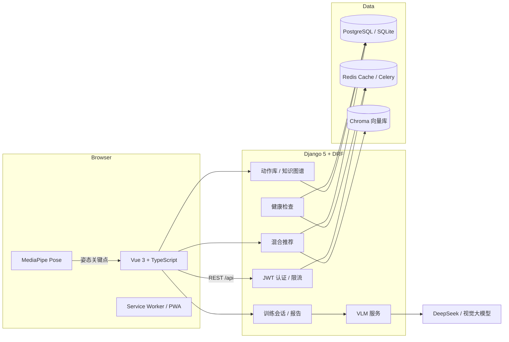

# FitVision

**AI 驱动的个人健身教练：姿态识别 · 动作纠错 · 个性化推荐 · 训练数据分析**

[](https://github.com/hhhxwhhh/FitVision/actions/workflows/ci.yml)
[](https://github.com/hhhxwhhh/FitVision/actions/workflows/codeql.yml)
[](LICENSE)
[](CONTRIBUTING.md)
[](https://vuejs.org/)
[](https://www.djangoproject.com/)
[](https://www.python.org/)

> FitVision is an AI-powered fitness coach. It uses browser-based pose estimation and
> vision-language models to score exercise form, recommends the next exercise with a
> hybrid recommendation pipeline, and turns every session into actionable analytics.
> The whole stack runs locally with one `docker compose up`.

---

## 目录

- [功能特性](#功能特性)
- [页面一览](#页面一览)
- [系统架构](#系统架构)
- [技术栈](#技术栈)
- [快速开始](#快速开始)
- [演示数据与演示账号](#演示数据与演示账号)
- [环境变量](#环境变量)
- [API 与文档](#api-与文档)
- [测试与代码质量](#测试与代码质量)
- [项目结构](#项目结构)
- [工程与技术亮点](#工程与技术亮点)
- [设计要点](#设计要点)
- [路线图](#路线图)
- [文档](#文档)
- [社区](#社区)
- [贡献](#贡献)

---

## 功能特性

### AI 训练闭环

- **实时姿态识别**：浏览器端 MediaPipe Pose 识别关键点，统计次数、计算动作标准度；支持深蹲、俯卧撑、开合跳、平板支撑、弓步蹲、卷腹六种模式。
- **节奏与速度分析（VBT）**：每次动作计算用时、平均速度与节奏分类（爆发 / 控制 / 偏慢），给出教练式节奏反馈。
- **视觉大模型纠错**：关键帧上传至兼容 OpenAI 协议的视觉模型（默认豆包），生成动作问题与改进建议。
- **AI 训练计划**：结合用户画像、目标、器械条件与**当日训练负荷状态**生成训练计划 —— 组数按容量系数自动伸缩，判定为"恢复优先"时还会插入主动恢复日。
- **训练报告**：本次亮点、需要改进、下一次建议，以及可继续训练的一键入口。

### 混合推荐系统

多路召回 + 加权融合，而不是单一规则：

| 引擎 | 作用 |
| --- | --- |
| DL Sequence（GRU + Attention） | 基于最近训练序列预测下一个动作 |
| Knowledge Graph（GCN） | 沿前置依赖与相似用户路径推荐 |
| Content-Based（M3E + Chroma） | 语义相似动作检索 |
| RL Adaptive | 根据疲劳与历史表现动态调节 |
| Time-Travel CF | 冷启动阶段匹配相似体质用户 |
| Cold Start | 热门动作兜底 |

召回后会继续做**目标导向重排**（减脂 / 增肌）、**疲劳联动抑制**、基于 **MMR（最大边际相关）**
的**相关性与多样性平衡重排**、**自适应探索**，并保留前置动作解锁校验。

### 训练负荷管理

- **准备度评分**：Banister 体能-疲劳冲激响应（TSB）+ EWMA 版 ACWR + Foster 单调性，
  再叠加动作质量趋势与恢复间隔，输出 0-100 分、建议强度与训练量系数，并附带判定理由。
- **负荷曲线**：数据中心逐日回放体能 / 疲劳 / TSB 走势，直观看出减量周与疲劳峰值。
- **容量联动**：训练计划的组数按今日容量系数伸缩，判定为"恢复优先"时自动插入主动恢复日。
- **分肌群恢复**：按协同肌矩阵与指数半衰期推算每个部位的恢复度、距完全恢复的小时数与本周有效组数，
  给出"今天优先练 / 先让它们恢复"的建议，并让推荐排序避开仍在酸痛的肌群。
- **力量曲线**：数据中心按动作展示等效 1RM 的历史曲线与趋势，并给出下一次训练的重量建议。
- **闭环**：训练记录可填「还能再做几次（RIR）」，反推的 1RM 会写进力量曲线，再由智能计划按 e1RM 折算出每个动作的建议重量。

### 成长与激励

- **经验与等级**：每次训练按时长、动作质量与连续天数结算 XP，自动升级并解锁称号。
- **每日任务**：按日期确定性生成 3 个任务，进度实时计算，完成后手动领取经验。
- **限时挑战**：周挑战与月挑战按周期自动刷新，先参加再领取，进度直接取自训练数据。
- **本周目标**：可自定义每周训练天数与分钟数，达成后领取周奖励。
- **成就系统**：里程碑、连续性、训练量、动作质量、探索与特别成就，服务端统一判定。
- **个人纪录**：自动记录每个动作的最大重量、最高次数、单次容量、最佳评分与等效 1RM。
- **本周经验榜**：赛季制周榜，支持公开/隐身切换，昵称脱敏展示。
- **状态就绪度**：服务端用负荷模型（体能-疲劳 + ACWR + 单调性）给出今日训练建议。
- 动作知识图谱与前置解锁，训练路径一目了然。
- 数据中心展示训练量、卡路里、动作标准度趋势。

### 现代 Web 体验

- Vue 3 + TypeScript + Element Plus，路由级代码分割。
- **统一设计系统**：`--fv-*` 设计令牌、明暗双主题、跟随系统偏好、首屏无闪烁。
- **全局命令面板**：`Ctrl/⌘ + K` 搜索动作、跳转页面、切换主题。
- **训练状态驾驶舱**：今日状态评分、AI 教练洞察、本周节奏与成就进度。
- **成长中心**：等级进度、每日任务、限时挑战、成就墙、个人纪录与本周经验榜。
- **训练历史时间线**：按月分组回看每一次训练，支持完成状态筛选与分页加载。
- **可安装 PWA**：离线应用外壳、桌面/移动端安装、快捷方式、在线状态提示。
- **数据导出**：训练统计一键导出 CSV，方便二次分析。
- JWT 自动续期、401 统一跳转、响应式布局、减少动效偏好支持。

---

## 页面一览

| 路由 | 页面 | 说明 |
| --- | --- | --- |
| `/` | 首页驾驶舱 | 今日状态、本周节奏、成就进度与快捷入口 |
| `/training` | 智能训练 | 姿态识别、实时计数、动作评分与语音教练 |
| `/training/report` | 训练报告 | 本次亮点、改进建议与下一步推荐 |
| `/ai-plan` | AI 训练计划 | 结合画像、目标与器械生成训练计划 |
| `/history` | 训练历史 | 按月分组的时间线，完成状态筛选与分页 |
| `/analytics` | 数据中心 | 训练量、卡路里、动作质量趋势与训练负荷曲线 |
| `/growth` | 成长中心 | 等级、任务、挑战、成就、周榜与训练负荷面板 |
| `/exercises` | 动作百科 | 动作库检索与筛选 |
| `/exercises/graph` | 知识图谱 | 前置依赖与训练路径 |
| `/posture-diagnosis` | 姿态诊断 | 视觉大模型动作纠错 |
| `/profile` | 个人中心 | 档案、目标与偏好 |

> 未登录访问受保护页面会跳转到 `/login`。按 `?` 打开快捷键面板，`Ctrl / ⌘ + K` 打开命令面板。

---

## 系统架构



---

## 技术栈

| 层 | 技术 |
| --- | --- |
| 前端 | Vue 3、TypeScript、Vite 7、Pinia、Vue Router、Element Plus、ECharts、MediaPipe Pose |
| 后端 | Python 3.12、Django 5.2、Django REST Framework、SimpleJWT、drf-spectacular |
| AI / 推荐 | PyTorch、GCN、GRU + Attention、scikit-learn、Chroma、sentence-transformers（M3E） |
| 数据 | PostgreSQL 16（生产）/ SQLite（开发与测试）、Redis、Celery |
| 工程化 | ESLint 9、Prettier、Black、isort、flake8、GitHub Actions、Docker Compose |

> 机器学习依赖（torch / chromadb / sentence-transformers）采用**按需加载**：
> 未安装时项目仍可启动，非 AI 接口与测试不受影响。

---

## 快速开始

### 方式一：Docker Compose（推荐）

```bash
git clone https://github.com/hhhxwhhh/FitVision.git
cd FitVision

cp .env.docker.example .env
# 编辑 .env：至少设置 SECRET_KEY 与 DB_PASSWORD

docker compose up --build
```

| 服务 | 地址 |
| --- | --- |
| 前端 | http://localhost:8080 |
| API 根 | http://localhost:8000/api/ |
| Swagger 文档 | http://localhost:8000/api/docs/ |
| 健康检查 | http://localhost:8000/api/health/ |

> 首次构建需要下载 PyTorch（CPU 版）与向量模型，耗时较长；后续启动会复用缓存。

### 方式二：本地开发

**环境要求**：Python 3.12、Node.js ≥ 20.19（推荐 22）。数据库可省略，后端会自动使用 SQLite。

```bash
# 1. 后端
cd backend
python -m venv .venv
# Windows: .venv\Scripts\activate
# macOS / Linux: source .venv/bin/activate
pip install -r requirements-dev.txt
cp .env.example .env              # 可全部留空，使用 SQLite + LocMem
python manage.py migrate
python manage.py seed_demo        # 自动导入动作库与示例训练计划（已有数据时跳过）
python manage.py seed_demo --with-history   # 可选：再生成演示用户的训练历史
python manage.py runserver

# 2. 前端（另开终端）
cd frontend
npm install
cp .env.example .env
npm run dev
```

打开 http://localhost:5173 。Vite 会将 `/api` 与 `/media` 代理到 `http://127.0.0.1:8000`。

> 需要 AI 诊断功能时，在 `backend/.env` 中配置 `CN_VLM_API_KEY`（视觉模型）与
> `DEEPSEEK_API_KEY`（文本 / 计划生成）。不配置不影响注册、训练记录与推荐等核心功能。

### 演示数据与演示账号

想直接看到"有数据"的效果，可生成一套**可复现**的演示数据：

```bash
cd backend
python manage.py seed_demo --with-history
```

- 演示账号：`demo` / `fitvision123`（仅用于本地演示，请勿用于生产）。
- 生成内容：8 周训练历史（会话、动作记录、交互）与用户统计；固定 `--seed` 即可复现。
- 参数可调：`python manage.py seed_demo_history --weeks 12 --days-per-week 5 --force`；
  `--no-periodization` 可关掉周期化，退回"每周负荷都一样"的旧行为。
- 生成的负荷是**周期化**的：4 周一循环，前 3 周渐进超负荷、第 4 周减量，
  因此首页的负荷比 / TSB 与成长页的近 4 周负荷图在演示数据上就有真实起伏。

> 历史数据由 `backend/utils/demo_data.py` 的确定性生成器产生，
> 测试可用 `python -m unittest utils.test_demo_data`。

需要给推荐算法更多样本时，可再生成一套**多用户合成数据集**（用户按初级 / 中级 / 高级
轮转，目标覆盖减脂 / 增肌 / 耐力 / 柔韧，各水平的动作评分确有差异）：

```bash
python manage.py seed_population --users 12 --weeks 6    # 或 make seed-population
```

---

## 环境变量

### 后端（`backend/.env`）

| 变量 | 默认值 | 说明 |
| --- | --- | --- |
| `DEBUG` | `True` | 生产环境必须为 `False` |
| `SECRET_KEY` | 开发用临时值 | 生产环境必填，建议随机 50+ 字符 |
| `ALLOWED_HOSTS` | `127.0.0.1,localhost` | 逗号分隔 |
| `CORS_ALLOWED_ORIGINS` | 本地 5173 / 8080 | 逗号分隔的前端源 |
| `DB_NAME` | 空 | 留空使用 SQLite；填写则连接 PostgreSQL |
| `DB_USER` / `DB_PASSWORD` / `DB_HOST` / `DB_PORT` | — | PostgreSQL 连接信息 |
| `CACHE_BACKEND` | `locmem` | `locmem` 或 `redis` |
| `REDIS_URL` | `redis://127.0.0.1:6379/0` | 缓存与 Celery |
| `DEEPSEEK_API_KEY` | 空 | 文本生成 / 计划 |
| `CN_VLM_API_KEY` | 空 | 视觉模型 API Key |
| `CN_VLM_MODEL` / `CN_VLM_BASE_URL` | 豆包 / OpenKey | OpenAI 兼容接口 |
| `SENTRY_DSN` | 空 | 可选错误上报 |
| `THROTTLE_ANON` / `THROTTLE_USER` / `THROTTLE_AUTH` | `60/min` / `600/min` / `10/min` | 限流 |
| `HF_ENDPOINT` | `https://hf-mirror.com` | 向量模型下载镜像 |

完整模板见 [`backend/.env.example`](backend/.env.example)。

### 前端（`frontend/.env`）

| 变量 | 默认值 | 说明 |
| --- | --- | --- |
| `VITE_API_BASE_URL` | `/api` | 生产环境可填完整地址 |
| `VITE_DEV_PROXY_TARGET` | `http://127.0.0.1:8000` | 开发代理目标 |

---

## API 与文档

- Swagger UI：`/api/docs/`
- OpenAPI Schema：`/api/schema/`
- 健康检查：`GET /api/health/`（检查数据库与缓存，供容器 / 负载均衡探活）
- 令牌刷新：`POST /api/auth/refresh/`

主要路由：

```
/api/auth/            注册、登录、刷新、用户档案、目标、统计
/api/exercises/       动作库、分类、知识图谱、训练记录
/api/training/        训练会话、计划、报告、AI 分析
/api/recommendations/ 个性化推荐与反馈
/api/analytics/       训练数据分析
/api/growth/          等级、每日任务、限时挑战、周目标、成就、个人纪录、排行榜、
                      负荷曲线、分肌群恢复、力量曲线、训练周期化（中周期）
/api/ai/              姿态诊断 / VLM 分析
```

---

## 测试与代码质量

```bash
# 后端（无需 PostgreSQL / Redis）
cd backend
DB_ENGINE=sqlite CACHE_BACKEND=locmem python manage.py check
DB_ENGINE=sqlite CACHE_BACKEND=locmem python manage.py test
DB_ENGINE=sqlite CACHE_BACKEND=locmem coverage run manage.py test && coverage report -m

# 前端
cd frontend
npm run lint
npm run type-check
npm run build
npm run size           # 体积预算守卫（gzip 超限即失败）
npm run test           # Vitest 单元测试
npm run test:coverage  # 覆盖率报告
```

CI 会在每次 Push / PR 时执行以上检查（含前后端测试覆盖率与体积预算），并验证
Docker Compose 镜像构建。另有 CodeQL 安全扫描与依赖自动更新（Dependabot）。本地可用
`pre-commit` 钩子在提交前自动格式化与校验，详见 [CONTRIBUTING.md](CONTRIBUTING.md)。

前端目前 **248 个测试 / 22 个测试文件**，覆盖姿态识别引擎、按键与滚动助手、
训练周期统计、CSV 导出、HTML 消毒、主题、负荷模型 / 分肌群恢复 / 力量曲线 / 周期化计划的解析层、用户状态，
以及 7 个组件级用例（训练日历、回到顶部、主题切换、AI 智能接力、肌群恢复面板、周期化面板、今日处方面板）。

后端 **343 个用例**，其中负荷模型 `utils/readiness` 有 53 个、分肌群恢复模型
`utils/recovery` 有 51 个、力量评估引擎 `utils/strength` 有 63 个、训练周期化引擎
`utils/periodization` 有 40 个、MMR 重排与演示数据生成器各有 10+ 个，都可以脱离 Django 直接运行；
成长体系与动作库另有 4 个**查询次数回归测试**，用 `CaptureQueriesContext` 断言接口的查询数
不随数据量线性增长，防止 N+1 悄悄回来：

```bash
cd backend
python -m unittest utils.test_readiness   # 训练负荷 / 准备度模型
python -m unittest utils.test_recovery    # 分肌群恢复模型
python -m unittest utils.test_strength   # 力量评估 / e1RM / 处方
python -m unittest utils.test_periodization # 训练周期化（中周期）模型
python -m unittest utils.test_demo_data   # 演示数据生成器
python -m unittest recommendations.test_rerank
```

---

## 项目结构

```text
FitVision/
├── backend/
│   ├── fitvision/          # 配置、URL、健康检查
│   ├── users/              # 认证、档案、目标、统计
│   ├── exercises/          # 动作库、分类、知识图谱
│   ├── training/           # 训练会话、计划、报告
│   ├── recommendations/    # 多引擎混合推荐
│   ├── analytics/          # 数据统计
│   ├── growth/             # 等级、任务、挑战、成就、纪录与排行榜
│   ├── ai_models/          # VLM 与姿态诊断
│   ├── utils/              # 向量库等基础设施
│   ├── requirements*.txt
│   ├── Dockerfile
│   └── .env.example
├── frontend/
│   ├── src/
│   │   ├── api/            # axios 客户端、自动刷新、媒体地址
│   │   ├── components/     # 通用组件与姿态预览
│   │   ├── composables/    # 姿态检测、表单指标、诊断逻辑
│   │   ├── layouts/        # 应用外壳
│   │   ├── router/         # 懒加载路由与守卫
│   │   ├── stores/         # Pinia
│   │   └── views/          # 页面
│   ├── scripts/            # 体积预算校验脚本
│   ├── public/             # PWA manifest、Service Worker、图标
│   ├── Dockerfile
│   └── nginx.conf
├── docs/                   # 架构 / 开发 / 部署文档（见 docs/README.md）
├── scripts/                # 资源生成与 pre-commit 包装脚本
├── .github/                # CI、CodeQL、发布、labeler、stale、ISSUE/PR 模板
├── docker-compose.yml
├── .pre-commit-config.yaml # 本地 Git 钩子（格式化 + commitlint）
├── CHANGELOG.md            # 版本变更记录
├── CONTRIBUTING.md
├── GOVERNANCE.md
├── SUPPORT.md
├── SECURITY.md
└── LICENSE
```

---

## 工程与技术亮点

### 按需加载与体积预算

Element Plus 与 ECharts 都采用按需引入（`unplugin-vue-components` + 显式注册所需图表），
不再整体打包。`scripts/check-bundle-size.mjs` 会对 gzip 后的入口 chunk、关键 CSS 与任一
JS chunk 设上限，超限即让 CI 失败，防止体积悄悄回退。

| 指标 | 优化前 | 当前 |
| --- | --- | --- |
| `dist` 总体积 | 3.0 MB | 2.2 MB |
| Element Plus chunk | 898 KB | 按需拆分为多个小 chunk |
| ECharts chunk | 1134 KB | 399 KB |
| JS 合计（gzip） | — | 583 KB |
| CSS 合计（gzip） | — | 62 KB |

### 算法侧的近期升级

- **训练准备度模型（Readiness）**：`backend/utils/readiness.py` 是一个纯 Python、零 Django 依赖的引擎，
  组合了三条运动科学主线 —— **Banister 体能-疲劳冲激响应**（τ=42d / τ=7d，差值即 TSB 竞技状态）、
  **EWMA 版 ACWR 急性慢性负荷比**（Williams 2017，甜蜜区 0.8–1.3）、**Foster 单调性/紧张度**；
  再叠加动作质量的最小二乘趋势与恢复间隔，输出 0-100 的准备度、建议强度与训练量系数，
  并附带"为什么这么评"的自然语言理由。冷启动时会对 ACWR 做置信度衰减，避免把新用户误判为过度训练。
- **分肌群恢复模型（Muscle Recovery）**：`backend/utils/recovery.py` 回答"今天该练哪个部位" —— 每次动作按
  `组数 × 次数 / 10`（计时动作按 `秒 / 60`）折算成刺激量，通过**协同肌权重矩阵**摊到主目标肌群与协同肌上
  （练胸会顺带疲劳肩和三头），再按各肌群的**指数半衰期**衰减（腿 72h、背 60h、胸 48h、腹 24h）得到残余疲劳，
  最终换算成 0-100 恢复度、距完全恢复的小时数、本周有效组数与推荐加权。推荐排序会按 60% 的强度对酸痛肌群降权，
  训练页据此给出"今天优先练 / 先让它们恢复"的建议。
- **力量评估引擎（Strength）**：`backend/utils/strength.py` 用三条互相独立的来源估计等效 1RM ——
  **次数公式**（Epley / Brzycki / Lombardi / Wathan 2018，取其中最保守的一个）、**速度推次**（VBT：向心速度反推
  这一重量还能做几次再折算 1RM）、**RPE / RIR 反推**（用百分比表从"还能再做几次"倒推）；三条来源可以互相校验，
  差异过大说明数据录错了。在此之上给出**双进阶处方**（做满次数就加 2.5% 重量，否则加次数）、e1RM 趋势与
  **减量周建议**（e1RM 下降 / 连续停滞 / 疲劳过高三个触发条件）。个人纪录新增 `e1rm` 类型。
- **训练周期化引擎（Periodization）**：`backend/utils/periodization.py` 把前三个引擎合成一条**时间轴**上的中周期计划 ——
  按经典周期化把 3–6 周拆成**积累 / 强化 / 实现 / 减量**四个阶段（容量系数 1.0 → 0.5，强度系数 0.72 → 0.92），
  容量由分肌群恢复模型给出的"本周剩余组数"决定（每周每肌群 10–20 组的目标区间），强度由 e1RM 决定
  （次数百分比表 × 阶段强度上限，再向下取整到配重片间隔）。准备度不足时整体容量自动打折（最低保留 60%），
  训练量再按推 / 拉 / 腿 / 核心的动作模式分配到各训练日，避免连续两天刺激同一肌群。
  每个肌群安排还会落到**具体动作**：优先用用户练过、有 e1RM 数据的动作，不够时从动作库补齐，
  组数在动作之间按"前面的动作多拿一组"的方式拆分 —— 计划因此是可以直接照着做的。
- **周期化计划接到训练页**：训练页新增「今日处方」卡片 —— 显示当前阶段（积累 / 强化 / 实现 / 减量）、
  今天这一训练日该做的**具体动作与重量**，没安排动作的日子会提示这是恢复日。
- **VBT（基于速度的训练）指标**：每次动作输出用时、平均速度与节奏分类，直接呈现在训练画面。
- **MMR 多样性重排**：推荐候选以最大边际相关重排，在相关性与冗余度之间做 λ 权衡，取代原先固定的肌群扣分。
- **六动作姿态引擎**：深蹲、俯卧撑、开合跳、平板支撑、弓步蹲、卷腹；每个模式都有自己的测量函数、评分权重与可提示纠错项。

### 可靠性

- **不信任 AI 输出**：模型返回的富文本在渲染前统一消毒（白名单标签、剥离全部属性），杜绝 `v-html` 注入。
- **可复现的演示数据**：`seed_demo --with-history` 以确定性种子生成数周的训练会话，让首页、统计与推荐从一开始就有数据。
- **可降级依赖**：SQLite / LocMem / 可选 ML 依赖均有回退路径，无需完整 ML 环境即可跑通测试。

---

## 设计要点

- **安全优先**：密钥只存在于 `.env`；生产强制随机 `SECRET_KEY`；JWT + 限流；
  CORS / CSRF / HSTS / X-Frame-Options 可配置；容器以环境变量注入配置。
- **可降级**：SQLite / LocMem / 可选 ML 依赖均有回退路径，新贡献者无需完整 ML 环境即可跑通测试。
- **可解释推荐**：每个推荐结果都带有来源标签与推荐理由，前端展示“为什么推荐它”。
- **体验细节**：路由级懒加载、PWA 离线外壳、自动令牌续期、减少动效偏好、统一焦点样式。

---

## 路线图

- [x] 训练负荷 / 准备度模型（Banister + ACWR + Foster）
- [ ] 使用 MediaPipe Tasks Vision（WASM）替换旧版 Pose 方案
- [ ] WebSocket 实时训练会话与多端同步
- [ ] 推荐算法离线评测集与 A/B 实验框架
- [ ] 中英文 i18n 与完整无障碍（a11y）审计
- [ ] 移动端封装（Capacitor / React Native）
- [ ] 更多视图层组件测试与端到端用例

---

## 文档

完整文档索引见 [`docs/README.md`](docs/README.md)：

- [架构说明](docs/ARCHITECTURE.md) · [数据流](docs/data_flow.md)
- [开发指南](docs/DEVELOPMENT.md) · [部署指南](docs/DEPLOYMENT.md)
- [本地运行](docs/run_guide.md) · [使用说明](docs/使用说明.md)

## 社区

- [贡献指南](CONTRIBUTING.md) · [行为准则](CODE_OF_CONDUCT.md) · [治理](GOVERNANCE.md)
- [获取帮助](SUPPORT.md) · [变更记录](CHANGELOG.md) · [安全策略](SECURITY.md)

## 贡献

欢迎提交 Issue 与 PR！请先阅读 [CONTRIBUTING.md](CONTRIBUTING.md) 与
[CODE_OF_CONDUCT.md](CODE_OF_CONDUCT.md)。安全问题请按 [SECURITY.md](SECURITY.md) 私密报告。
建议安装 pre-commit 钩子（见贡献指南），提交信息遵循 Conventional Commits。

## License

[MIT](LICENSE) © 2026 FitVision contributors
