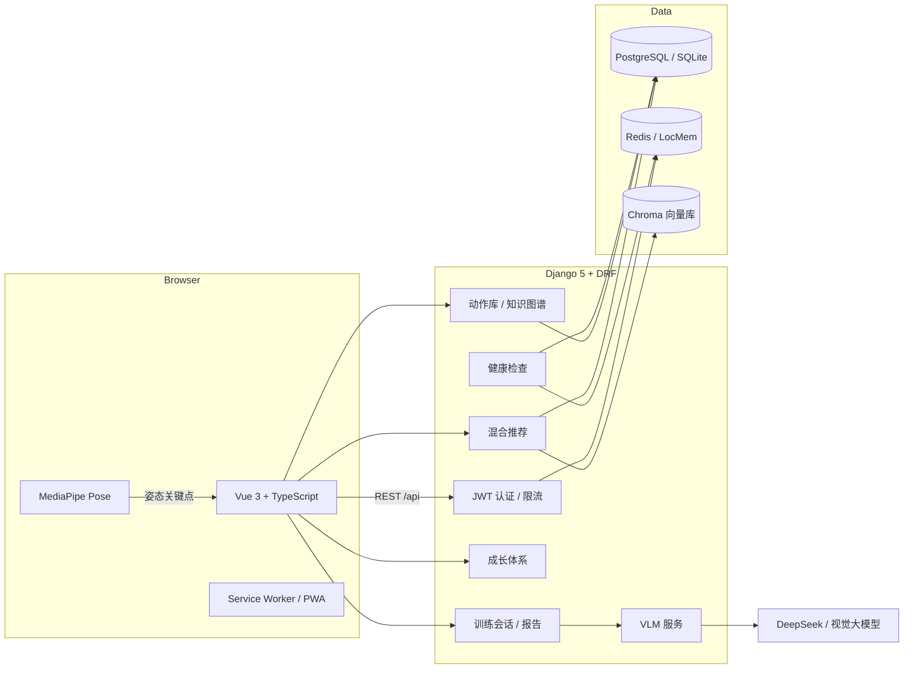

# 系统架构

FitVision 采用前后端分离架构：浏览器负责实时姿态识别与渲染，Django 负责鉴权、
训练数据、推荐与 AI 编排，AI/推荐依赖按需加载并可降级。

## 总览

## 前端（`frontend/`）

- **Vue 3 + TypeScript + Vite 7**，路由级代码分割，Pinia 管理状态。
- **姿态识别**：`MediaPipe Pose` 在浏览器端提取关键点，`usePoseDetection` /
  `poseRecognition` 完成计数与动作标准度计算，避免上传视频、保护隐私。
- **设计系统**：`--fv-*` 设计令牌 + 明暗双主题，首屏无闪烁。
- **PWA**：Service Worker 提供离线外壳与安装入口。
- 目录说明见 [frontend.md](frontend.md)。

## 后端（`backend/`）

按领域拆分的 Django app：

| App | 职责 |
| --- | --- |
| `users` | 认证、用户档案、目标、统计 |
| `exercises` | 动作库、分类、知识图谱 |
| `training` | 训练会话、计划、报告 |
| `recommendations` | 多引擎混合推荐 |
| `analytics` | 数据统计 |
| `growth` | 等级、任务、挑战、成就、纪录、排行榜 |
| `ai_models` | VLM 与姿态诊断编排 |
| `utils` | 向量库等基础设施 |

目录说明见 [backend.md](backend.md)。

## 推荐流水线

多路召回 + 加权融合，再做目标导向重排、疲劳联动抑制、肌群多样性重排与自适应探索：

- DL Sequence（GRU + Attention）— 序列预测
- Knowledge Graph（GCN）— 沿前置依赖推荐
- Content-Based（M3E + Chroma）— 语义相似
- RL Adaptive — 动态调节
- Time-Travel CF — 冷启动匹配
- Cold Start — 热门兜底

每个推荐结果都带有来源标签与理由，前端展示"为什么推荐它"。

## 关键设计原则

- **隐私优先**：姿态关键点在浏览器端处理，不上传原始视频。
- **可降级**：SQLite / LocMem / 可选 ML 依赖均有回退路径，无完整 ML 环境也能跑通测试。
- **可解释**：推荐与 AI 建议都带来源与理由。
- **安全**：JWT + 限流，CORS/CSRF/HSTS 可配置，密钥仅存于环境变量。

数据流动细节见 [data_flow.md](data_flow.md)。
